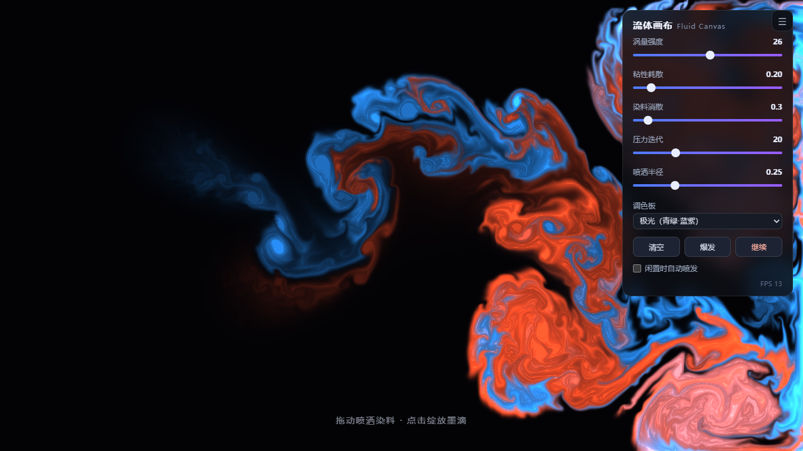
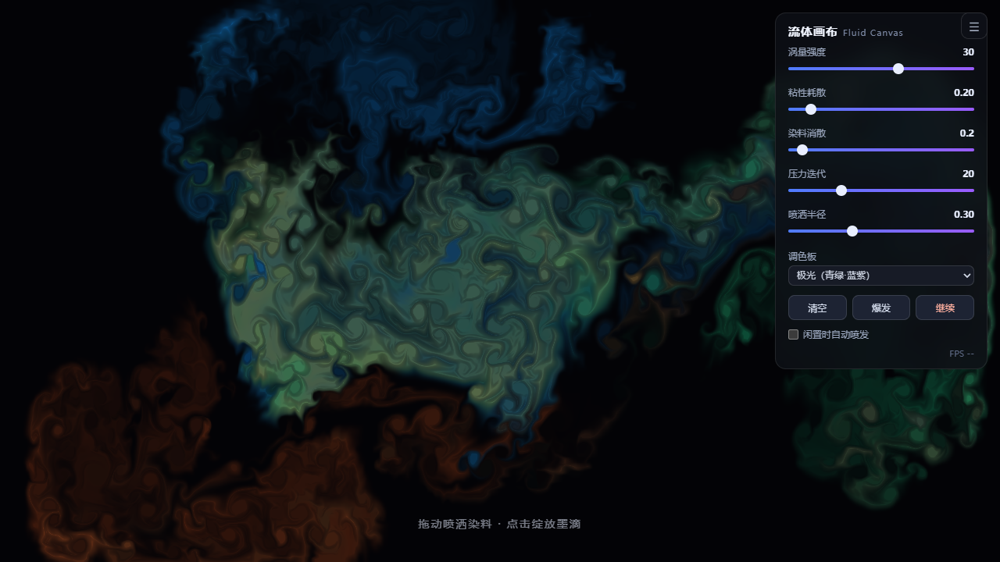
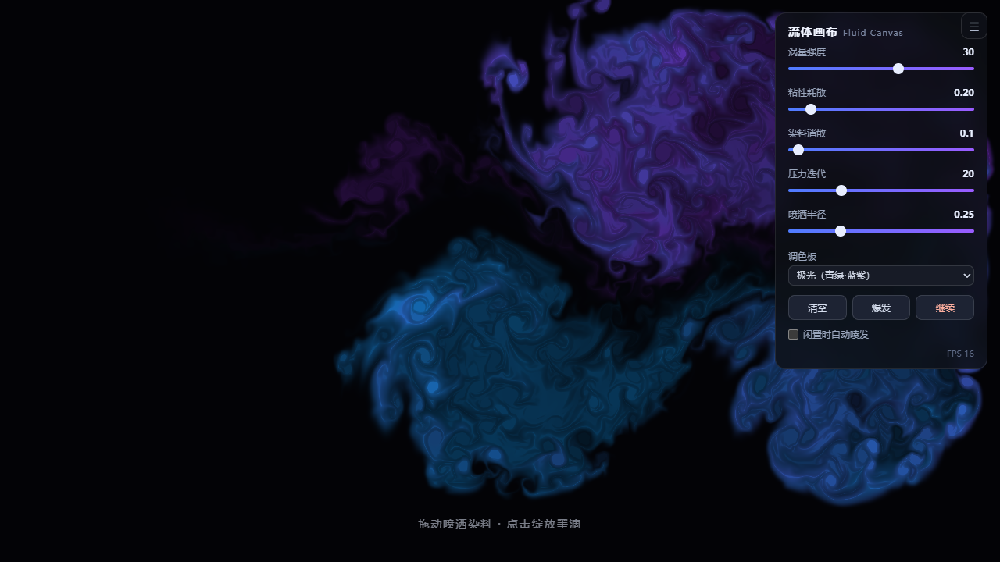
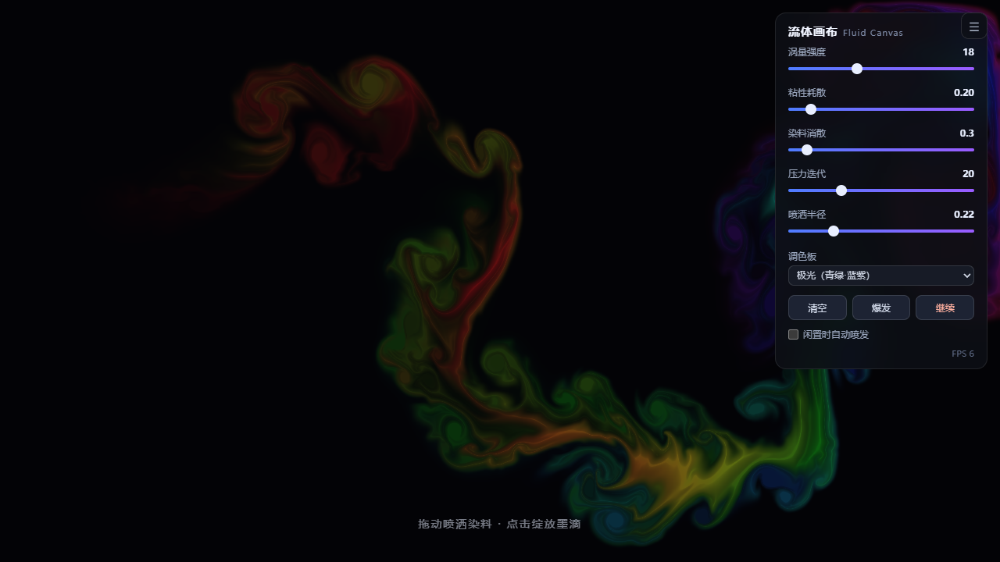
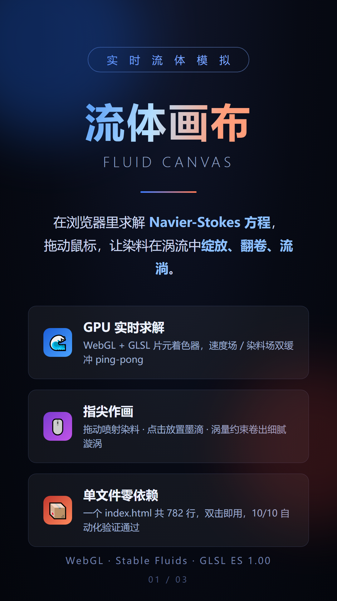
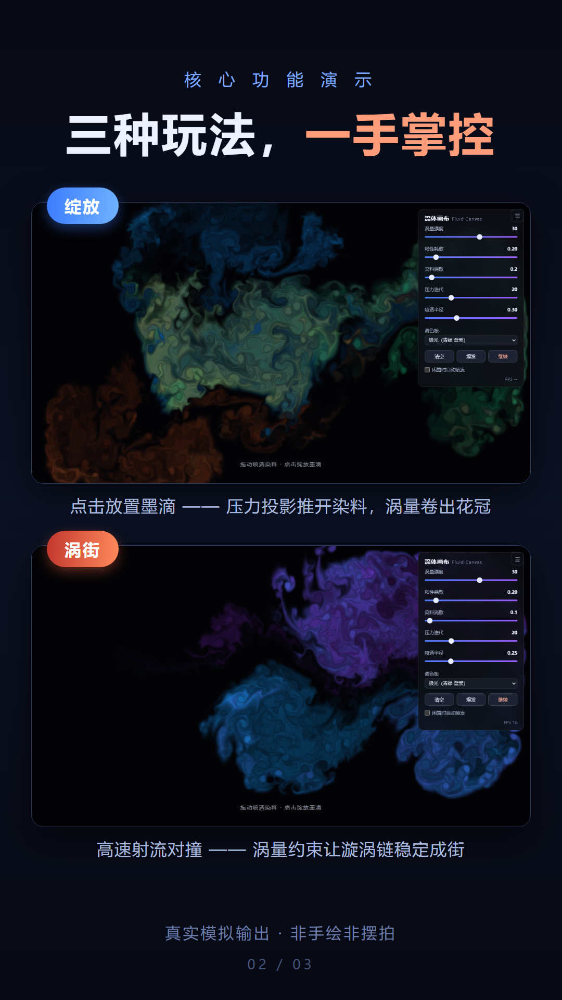
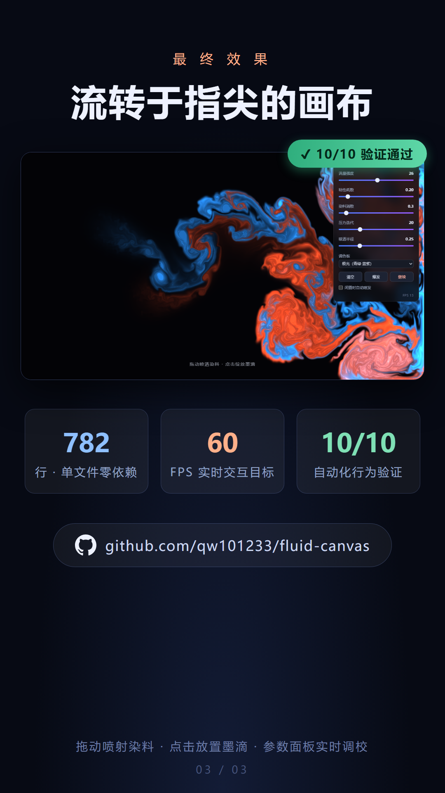

# 流体画布 Fluid Canvas

**在浏览器里求解 Navier-Stokes 方程——拖动鼠标，让染料在涡流中绽放、翻卷、流淌。**

一个单文件、零依赖、零构建的 WebGL 实时流体染料模拟器。打开 `index.html`，画布即流体：指尖划过喷出染料，点击落下墨滴，涡量约束让每一个漩涡都清晰可辨。



## 项目背景

流体是实时图形领域最迷人的主题之一：它既是严谨的数值计算（Navier-Stokes 方程的 GPU 求解），又是随手可玩的视觉玩具。本项目想证明一件事——**不用任何库、任何构建工具，一个 HTML 文件就能在浏览器里跑起一套完整的欧拉流体求解器**，而且美得能当壁纸。

实现采用 Jos Stam 的经典 **Stable Fluids**（1999）方案，全部计算在 GLSL 片元着色器中完成，CPU 只负责发号施令。

## 功能介绍

### 🌊 GPU 实时求解
- **半拉格朗日平流**（Advection）：速度场自平流 + 染料场被速度场搬运
- **Jacobi 迭代压力求解**（默认 20 次迭代）+ 梯度减除，保证不可压缩性
- **涡量约束**（Vorticity Confinement）：补偿数值耗散，让小漩涡不消失
- 双 FBO **ping-pong** 渲染，RGBA half-float 纹理；支持线性过滤的硬件走优化路径

### 🖱️ 指尖作画
- **拖动** = 喷射染料 + 注入动量（颜色随 HSV 调色板流动变化）
- **单击** = 放置墨滴，径向爆发后由压力场自然推开花冠
- 多点触控（Pointer Events）支持

### 🎛️ 参数面板
玻璃拟态控制台，实时可调：涡量强度、粘性耗散、染料消散、压力迭代次数、喷洒半径、5 种调色板（霓虹 / 海洋 / 熔岩 / 翡翠 / 单色），一键清空、爆发、暂停，还有"闲置时自动爆发"演示模式。

### 🐛 调试 API
暴露 `window.fluid`：`splat / step / reset / readPixels / setParams / _readField` 等，自动化验证与演示录制全靠它——不模拟鼠标，直接调 API，稳定一个量级。

## 安装与运行

**零安装**：双击 `index.html`，或拖进任何现代浏览器（Chrome / Edge / Firefox / Safari）。

```bash
# 可选：本地服务
python -m http.server 8000   # 然后访问 http://localhost:8000
```

**运行自动化验证**（需 Node.js + Playwright）：

```bash
NODE_PATH=<playwright 安装位置>/node_modules node tools/verify.mjs
# 期望输出：10/10 PASSED
```

验证覆盖：清屏基线 → splat 染料注入 → 平流方向性（质心右移）→ 无速度对照组 →
参数热更新 → 涡量约束 → 600 步数值稳定性 → 交互路径 → FPS → 零 JS 报错。

## 项目结构

```
fluid-canvas/
├── index.html            # 全部实现：HTML + CSS + JS + GLSL（782 行）
├── PROJECT.md            # AI 接手用项目说明（判重 + 历史决策）
├── screenshots/          # 脚本生成的演示截图 ×5
├── slides/               # 9:16 竖屏介绍幻灯片 HTML 源文件 ×3
├── deliverables/         # 幻灯片成品 PNG ×3（抖音比例 1080×1920）
└── tools/
    ├── verify.mjs        # Playwright 行为验证（10 项断言）
    ├── shots.mjs         # 演示截图生成
    └── render-slides.mjs # 幻灯片渲染 + 溢出检测
```

## 成果展示

| 墨滴绽放 | 涡街 | 流带 |
|---|---|---|
|  |  |  |

**9:16 竖屏介绍图文**（见 `deliverables/`）：





### 质量验证

- ✅ **10/10 自动化行为验证通过**（Playwright + swiftshader 软件渲染，无头可复现）
- ✅ 平流方向性：注入点 x=0.300，15 步后染料质心右移至 x=0.364；无速度对照组不漂移
- ✅ 600 步连续模拟无数值爆炸（能量有界）
- ✅ 软件渲染下 50 FPS；真机 GPU 上 60 FPS 无压力

## 技术要点（给想读代码的你）

| 模块 | 位置（index.html 内） | 说明 |
|---|---|---|
| 着色器 | 顶部 `<script type="x-shader">` | 平流/压力/梯度减除/涡量/splat/显示 各一个 program |
| 场管理 | `createFBO` / `createDoubleFBO` | half-float 纹理 + ping-pong |
| 求解循环 | `step()` | curl → vorticity → divergence → pressure(Jacobi×N) → gradientSubtract → advect |
| 调色板 | `generateColor()` | 5 种 HSV 策略 |
| 调试 API | `window.fluid` | 验证/录制入口 |

## License

MIT
